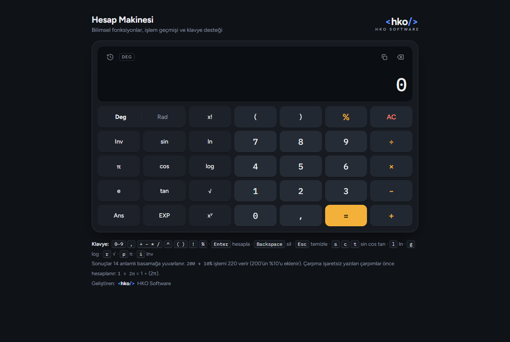

# Bilimsel Hesap Makinesi

**Hemen kullan:** https://nihathko.github.io/hesap-makinesi/

Tarayıcıda çalışan, kurulum gerektirmeyen bilimsel hesap makinesi. Tek bir `index.html` dosyasından oluşur; indirip çift tıklamanız yeterli.

## Özellikler

- Dört işlem, parantez, üs alma (`xʸ`), kök, faktöriyel (`x!`), yüzde
- Bilimsel fonksiyonlar: `sin`, `cos`, `tan` ve tersleri, `ln`, `log`, `eˣ`, `10ˣ`, `√`, `x²`
- Derece / radyan seçimi, `π`, `e`, `Ans` (son sonuç), `EXP` (bilimsel gösterim)
- İşlem geçmişi (son 40 işlem, tarayıcıda saklanır)
- Sonucu kopyalama
- Klavye desteği
- Açık ve koyu tema (cihaz ayarına göre)
- Telefon, tablet ve bilgisayarda çalışır
- Türkçe sayı biçimi: `1.234.567,89`

## Hesaplama kuralları

| Örnek | Sonuç | Açıklama |
|---|---|---|
| `2 + 3 × 4` | 14 | Çarpma ve bölme önce yapılır |
| `0,1 + 0,2` | 0,3 | Sonuçlar 14 anlamlı basamağa yuvarlanır |
| `200 + 10%` | 220 | 200'ün %10'u eklenir |
| `200 × 10%` | 20 | |
| `2 ^ 3 ^ 2` | 512 | Üs sağdan sola hesaplanır |
| `−3 ^ 2` | −9 | Üs, eksi işaretinden önce gelir |
| `1 ÷ 2π` | 0,159… | Çarpma işaretsiz çarpımlar önce hesaplanır: 1 ÷ (2π) |
| `1 ÷ 0`, `√−4`, `tan 90°` | Tanımsız | |

## Klavye kısayolları

| Tuş | İşlev |
|---|---|
| `0–9`, `,` | Rakam ve ondalık |
| `+ − * /` | İşlemler |
| `^`, `!`, `%`, `( )` | Üs, faktöriyel, yüzde, parantez |
| `Enter` | Hesapla |
| `Backspace` / `Esc` | Sil / Temizle |
| `s` `c` `t` | sin, cos, tan |
| `l`, `g`, `r` | ln, log, √ |
| `p`, `e`, `i` | π, e, Inv (ters fonksiyonlar) |

## Kullanım

Yukarıdaki linkten doğrudan kullanabilir ya da `index.html` dosyasını indirip tarayıcıda açabilirsiniz. Telefonda "Ana ekrana ekle" ile uygulama gibi kullanılabilir. İnternet bağlantısı yalnızca yazı tiplerini yüklemek için kullanılır; bağlantı yoksa sistem yazı tipiyle çalışmaya devam eder.

---

Geliştiren: **HKO Software**

## Lisans

MIT Lisansı: ücretsiz kullanılabilir, değiştirilebilir ve paylaşılabilir; telif notunun (HKO Software) korunması yeterlidir. Ayrıntılar için [LICENSE](LICENSE) dosyasına bakın.
